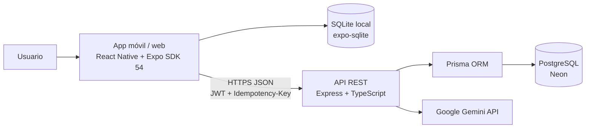
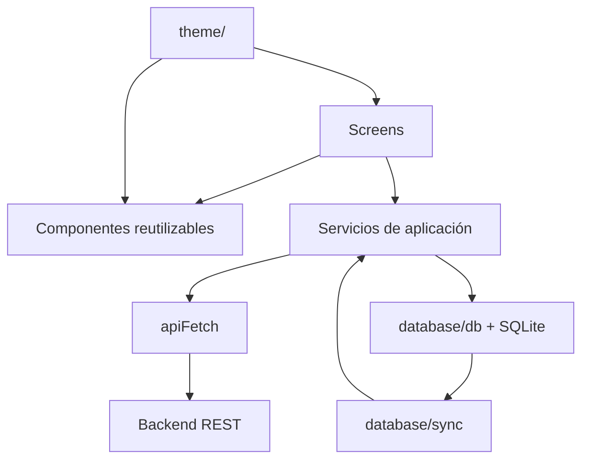
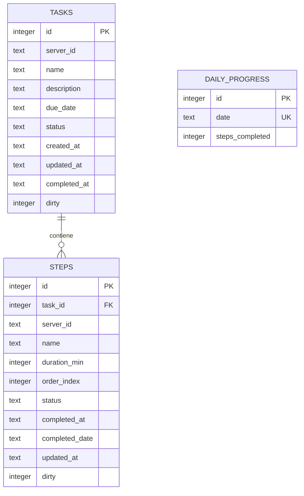
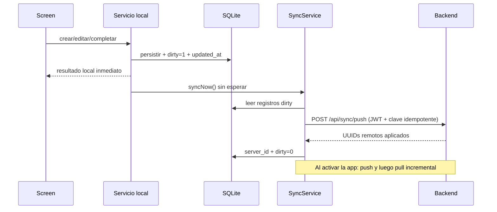
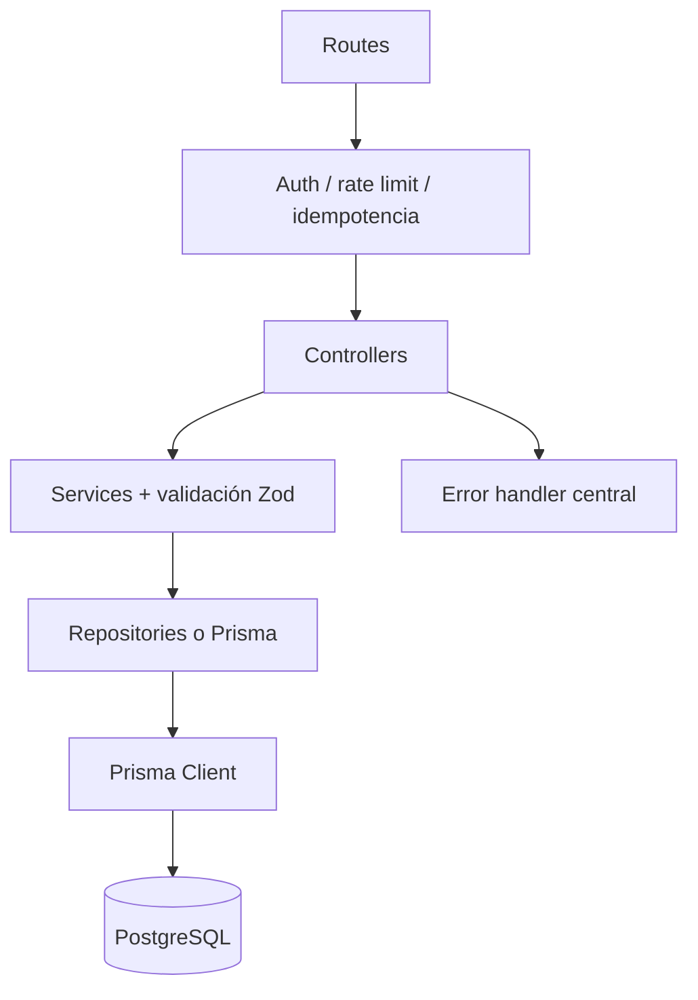

# Arquitectura actual de StepUp

> **Estado relevado:** 27 de octubre de 2026.
> **Alcance:** arquitectura implementada en el repositorio, no solo la planificada. Este documento complementa `docs/Contexto.md`, el PRD de E3 y los análisis específicos de backend y sincronización.

## 1. Visión general

StepUp es una aplicación móvil *local-first* para combatir la procrastinación. El dato operativo vive primero en el dispositivo: una persona puede crear, editar y completar tareas sin cuenta ni conexión. Cuando inicia sesión, la misma base local se sincroniza con una API REST remota.

La aplicación está formada por dos ejecutables y dos almacenamientos persistentes:



| Área | Implementación actual |
| --- | --- |
| Cliente | React Native 0.81, React 19, Expo SDK 54 y TypeScript |
| Navegación | React Navigation: stack raíz, cuatro tabs y stacks anidados |
| Datos locales | `expo-sqlite`, migraciones versionadas hasta `user_version = 7` |
| Sesión | JWT persistido con AsyncStorage en nativo y `localStorage` en web |
| API | Node.js, Express 5, TypeScript, Zod, Helmet, CORS y rate limiting |
| Datos remotos | Prisma 6 sobre PostgreSQL en Neon |
| IA | Proxy autenticado a Gemini desde el backend; la clave no llega al bundle |
| Despliegue previsto/actual | Backend en Render y PostgreSQL en Neon |

## 2. Estructura del repositorio

```text
stepup/
├── App.tsx                         # bootstrap de fuentes, sesión, navegación y ciclo sync
├── src/
│   ├── screens/                    # composición de cada pantalla y estado de UI local
│   ├── components/                 # catálogo visual reutilizable Zenith Vitality
│   ├── services/                   # casos de uso locales/remotos y estado de sesión
│   ├── database/                   # conexión SQLite, migraciones, sync y seed de desarrollo
│   ├── theme/                      # tokens, responsive y layout de navegación
│   ├── hooks/                      # conectividad
│   ├── types/                      # modelos de dominio y contratos de navegación
│   └── utils/                      # fechas, borradores y resolución de conflictos
├── backend/
│   ├── src/                        # API Express por capas
│   └── prisma/                     # esquema y migraciones PostgreSQL
├── docs/                           # documentación funcional y técnica
└── assets/                         # recursos estáticos
```

El frontend no usa un gestor global de estado (Redux, Zustand o React Query). El estado de interfaz queda en cada pantalla mediante hooks de React; el estado de dominio persistente se consulta y muta a través de servicios. SQLite funciona como fuente de verdad local y como cola de cambios para sincronización.

## 3. Arquitectura del cliente

### 3.1 Capas y dependencias



La regla de acceso es: las pantallas no ejecutan SQL ni consumen `fetch` directamente. Delegan los casos de uso a `src/services/`; estos leen o escriben SQLite y, cuando corresponde, disparan una sincronización no bloqueante.

### 3.2 Arranque y sesión

`App.tsx` concentra el bootstrap:

1. Evita que el splash se cierre hasta cargar Manrope y Plus Jakarta Sans.
2. Recupera el token de sesión desde `storage`.
3. Lee `hasSeenOnboarding` y elige la ruta inicial:
   - con token: `MainTabs`;
   - sin token y sin onboarding visto: `Onboarding1`;
   - sin token con onboarding visto: `Login`.
4. Inicia `startSyncLifecycle()`, que reintenta sincronizar al activar la app y hace *push* al ir a segundo plano.

`storage.ts` abstrae la persistencia de claves: AsyncStorage en Android/iOS y `localStorage` en web. `session.ts` mantiene además una caché en memoria del token para construir los headers de cada petición.

### 3.3 Navegación

```text
RootStack
├── Onboarding1 → Onboarding2 → NotificationPermission
├── Login ↔ Register
└── MainTabs
    ├── FocusStack: FocusMain
    ├── TasksStack: TaskList → TaskDetail → TaskForm | StepForm | StepComplete
    ├── HistoryStack: HistoryMain
    └── ProfileStack: ProfileMain → Badges | SyncConflict
```

`GlassTabBar` implementa las cuatro tabs (`Ahora`, `Tareas`, `Historial`, `Perfil`). El FAB se renderiza desde `AppContent` únicamente en la raíz de `TaskList`; para ello inspecciona el estado de navegación del stack de tareas.

### 3.4 Pantallas y capacidades

| Módulo | Pantallas | Responsabilidad |
| --- | --- | --- |
| Incorporación y acceso | `OnboardingScreen1`, `OnboardingScreen2`, `NotificationPermissionScreen`, `LoginScreen`, `RegisterScreen` | Explicar el producto, solicitar permiso visual y crear/iniciar sesión. |
| Flujo principal | `FocusScreen`, `StepCompleteScreen` | Mostrar un único paso pendiente, controlar el timer y celebrar la finalización. |
| Gestión | `TaskListScreen`, `TaskDetailScreen`, `TaskFormScreen`, `StepFormScreen` | CRUD de tareas y pasos, orden, descripción y generación asistida. |
| Historial | `HistoryScreen` | Tareas terminadas y progreso diario/semanal disponible localmente. |
| Cuenta y sync | `ProfileScreen`, `BadgesScreen`, `SyncConflictScreen` | Perfil, insignias de UI y elección de versiones en conflictos de sincronización. |

### 3.5 Servicios de aplicación

| Servicio | Responsabilidad |
| --- | --- |
| `TaskService` | CRUD local de tareas, creación conjunta con borrador de pasos y disparo de sync. |
| `StepService` | CRUD, orden, lote de pasos, completar/reabrir y actualización de la tarea padre. |
| `ProgressService` | Consultas del contador diario y de los últimos siete días. |
| `TimerService` | Singleton en memoria de cuenta regresiva o ascendente; no persiste el timer. |
| `AuthService` | Registro, login, cambio seguro de propietario local, carga inicial y logout. |
| `SyncService` | Migración inicial, push, pull y resolución de conflictos. |
| `AIService` | Cliente de sugerencias de pasos y guía para escribir descripciones. |
| `api.ts` | URL base, endpoints, JSON, token Bearer e interpretación uniforme de errores HTTP. |

El timer se detiene o reinicia al desmontar/cambiar el flujo de UI; no pretende recuperar tiempo tras cerrar la aplicación. La IA tampoco forma parte de la transacción de creación: genera un borrador editable y descartable, que solo se persiste cuando la persona lo confirma.

## 4. Datos locales y modelo de dominio

### 4.1 Entidades principales



Las tareas están en estado `active` o `completed`; los pasos, en `pending` o `completed`. Al completar un paso, `StepService` registra la fecha local (`completed_date`) y aumenta `daily_progress`. Si no quedan pasos pendientes, también completa la tarea. Reabrir un paso reactiva la tarea si era necesario.

### 4.2 Tablas técnicas de sincronización

| Tabla | Uso |
| --- | --- |
| `sync_meta` | Último pull exitoso y `owner_user_id` de los datos locales. |
| `sync_conflicts` | Versiones local y remota detectadas dentro de la ventana de conflicto. |
| `pending_idempotency_keys` | Claves UUID persistentes para repetir con seguridad `sync-push` y `sync-migrate`. |

`getDb()` abre el singleton `stepup.db`, habilita claves foráneas y ejecuta todas las migraciones. Usa WAL en nativo y `MEMORY` como journal en web. El seed solo corre con `EXPO_PUBLIC_SEED_DB=true`.

### 4.3 Versionado de SQLite

| Versión | Cambio |
| --- | --- |
| V1 | Tareas, pasos y progreso diario. |
| V2 | `server_id`, `dirty`, `updated_at` y `sync_meta`. |
| V3 | Persistencia de conflictos. |
| V4 | Propietario local para aislar cuentas. |
| V5 | Idempotencia persistente del cliente. |
| V6 | Descripción de tarea para contexto de IA. |
| V7 | Fecha local de finalización de pasos, independiente de UTC. |

## 5. Sincronización offline-first

La cuenta es opcional. Sin sesión, la app opera exclusivamente contra SQLite. Con sesión, cada mutación se confirma primero localmente y luego intenta un *push* en segundo plano. Un error de red no revierte la acción ni bloquea la interfaz.



### 5.1 Push, pull y migración

- **Push:** toma tareas y pasos con `dirty = 1`; envía su ID local y, si existe, su UUID remoto. Un paso puede referenciar la tarea por UUID o por ID local cuando ambos nacieron offline en el mismo lote.
- **Pull:** consulta `/api/sync/pull?since=<last_sync_at>`, aplica tareas antes que pasos y avanza el marcador local tras procesar la respuesta.
- **Migración:** al registrarse desde una instalación sin cuenta, `/api/sync/migrate` crea usuario, tareas y pasos en una transacción, devuelve JWT y mapea IDs locales a UUIDs remotos.
- **Cambio de cuenta:** si la base pertenece a otro usuario, se elimina el contenido local antes de asociarla al nuevo propietario; evita exponer o subir datos ajenos.

### 5.2 Resolución de versiones

El criterio normal es **last-write-wins** comparando `updated_at`. Si hay una modificación local no enviada y una remota cercana en el tiempo (ventana de 60 segundos), no se descarta silenciosamente: se guarda un registro en `sync_conflicts` y `SyncConflictScreen` permite conservar la versión local o la del servidor.

Las claves de idempotencia se guardan junto con un hash del payload. Si un intento falla por red, el reintento conserva la misma clave; al recibir éxito se elimina. Esto evita duplicar operaciones que el servidor pudo haber aplicado antes de que se perdiera la respuesta.

## 6. Backend

### 6.1 Capas



`backend/src/server.ts` carga el entorno y escucha el puerto configurado. `app.ts` crea Express, configura `trust proxy`, Helmet, CORS con lista permitida, JSON, rutas y manejo centralizado de errores. Los servicios concentran reglas de dominio y los repositorios encapsulan gran parte de las consultas Prisma; el servicio de sync usa transacciones Prisma directamente para procesar lotes de manera atómica.

### 6.2 Modelo remoto

PostgreSQL replica el dominio local con IDs UUID y propiedad por usuario:

```text
User 1 ── * Task 1 ── * Step
  ├── * DailyProgress (único por userId + date)
  └── * IdempotencyKey (único por userId + key)
```

`Task` y `Step` tienen `createdAt`, `updatedAt` y `completedAt`. `DailyProgress` está separado por usuario. `IdempotencyKey` guarda hash de solicitud, método, ruta, respuesta y expiración para permitir replay seguro de mutaciones remotas.

### 6.3 Superficie HTTP

| Grupo | Rutas principales | Protección |
| --- | --- | --- |
| Salud | `GET /health`, `GET /api/health` | Pública |
| Auth | `POST /api/auth/register`, `POST /api/auth/login`, `GET /api/auth/me` | Limitadores de registro/login; `/me` requiere JWT |
| Tareas | `/api/tasks` y `/api/tasks/:id` | JWT; mutaciones aceptan `Idempotency-Key` UUID |
| Pasos | `/api/steps`, `/api/tasks/:taskId/steps` | JWT; mutaciones aceptan `Idempotency-Key` UUID |
| Progreso | `GET /api/progress` | JWT |
| Sync | `POST /api/sync/push`, `GET /api/sync/pull`, `POST /api/sync/migrate` | Push/pull con JWT; migrate con rate limit, credenciales e idempotencia |
| IA | `POST /api/ai/suggest-steps`, `POST /api/ai/describe-help` | JWT y máximo general de 10 solicitudes/minuto fuera de test |

Los endpoints protegidos verifican un JWT Bearer y asocian el usuario a la request. Las operaciones de tareas, pasos y sync validan los cuerpos con Zod y verifican propiedad para evitar acceso cruzado entre usuarios.

## 7. Integración de IA

La aplicación no llama a Gemini directamente. `AIService` del cliente consume la API propia; el backend construye el prompt, limpia entradas, llama a Gemini, valida y normaliza la respuesta.

```mermaid
flowchart LR
  F[TaskForm / TaskDetail] --> G{¿Hay sesión y red?}
  G -- No --> M[Creación manual disponible]
  G -- Sí --> C[AIService cliente]
  C --> B[/api/ai/*]
  B --> V[Zod + sanitización + cache LRU]
  V --> GM[Gemini]
  GM --> D[Borrador editable]
  D -->|Confirmar| L[TaskService / StepService]
  D -->|Descartar| M
```

El backend usa `GEMINI_API_KEY` y, por defecto, `gemini-3.5-flash`. La configuración falla de forma cerrada si falta la clave fuera de tests. Las sugerencias se limitan y normalizan a entre 3 y 8 pasos de 5 a 25 minutos; el cache LRU reduce llamadas repetidas. La ausencia de red, una cuota agotada o un error del proveedor solo muestran un mensaje: el flujo manual sigue disponible.

## 8. Diseño, responsive y accesibilidad

La capa visual sigue el sistema Zenith Vitality:

- Los tokens en `src/theme/` son la única fuente para colores, tipografía, espaciado, radios y sombras.
- `src/components/` contiene los bloques reutilizables: botones, cards, campos, progreso, timer, tab bar, FAB, gráfico, confetti y borrador de pasos sugeridos.
- El baseline responsive es 375 px; en web se limita a 600 px. `scale()` se reserva para elementos visuales absolutos, no para tipografía ni espaciado.
- `SafeAreaProvider`, `useSafeAreaInsets` y `useBottomLayout()` evitan offsets fijos frente a barras y notches.
- Los controles reutilizables declaran semántica de accesibilidad y respetan objetivos táctiles mínimos.

La plataforma primaria de validación es Android mediante Expo Go. La interfaz web existe como soporte de desarrollo y pruebas, pero no reemplaza la validación nativa.

## 9. Calidad y pruebas

| Parte | Herramientas | Cobertura principal |
| --- | --- | --- |
| Cliente | Vitest + `sql.js` | Servicios, migraciones, sync, sesión, fechas, borradores y pantallas puntuales. |
| Backend | Jest + Supertest | Auth, tareas, pasos, sync, migración, idempotencia, IA, seguridad y manejo de errores. |
| Estático cliente | TypeScript y ESLint | `npm run typecheck`, `npm run lint` |
| Build backend | TypeScript | `npm run build` dentro de `backend/` |

Comandos de validación definidos actualmente:

```bash
npm test
npm run lint
npm run typecheck
cd backend
npm test
npm run build
```

## 10. Límites y trabajo pendiente conocido

Esta descripción refleja lo implementado. Los siguientes puntos están explícitamente fuera del alcance cerrado de E3 o permanecen como evolución:

- Dashboard de consistencia completo: racha y tendencia visual como funcionalidad de producto.
- Sistema XP/niveles y segunda versión de notificaciones push.
- Notificaciones push FCM operativas; la pantalla de permiso actual no equivale a una integración completa de entrega de notificaciones.
- Pulido visual y de animaciones de los slices pospuestos.

Al evolucionar la arquitectura, se deben conservar los principios vigentes: SQLite como primer destino de escritura, servicios como frontera de acceso a datos, sincronización tolerante a fallos, secretos exclusivamente en el backend y tokens del theme para toda decisión visual.
